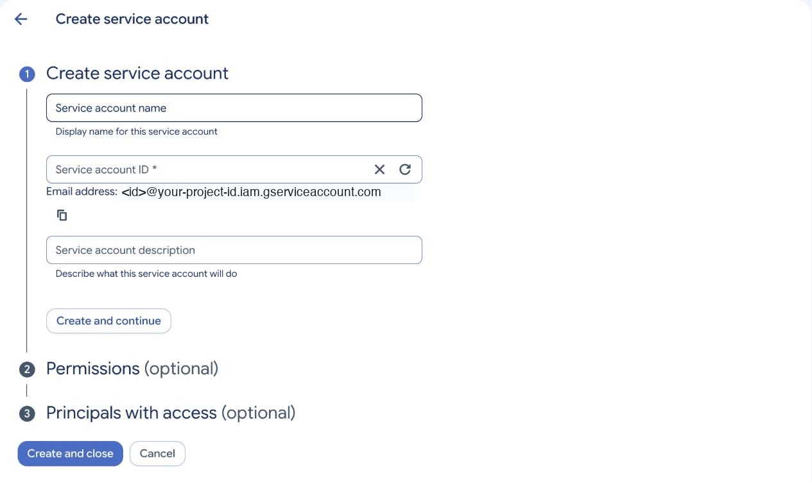
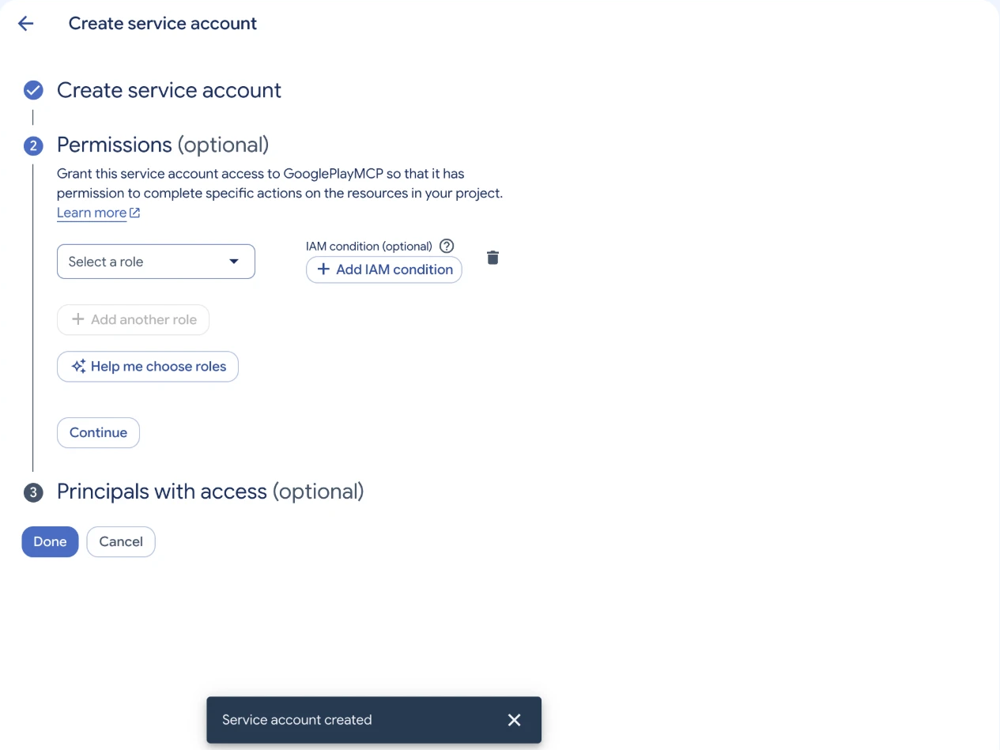
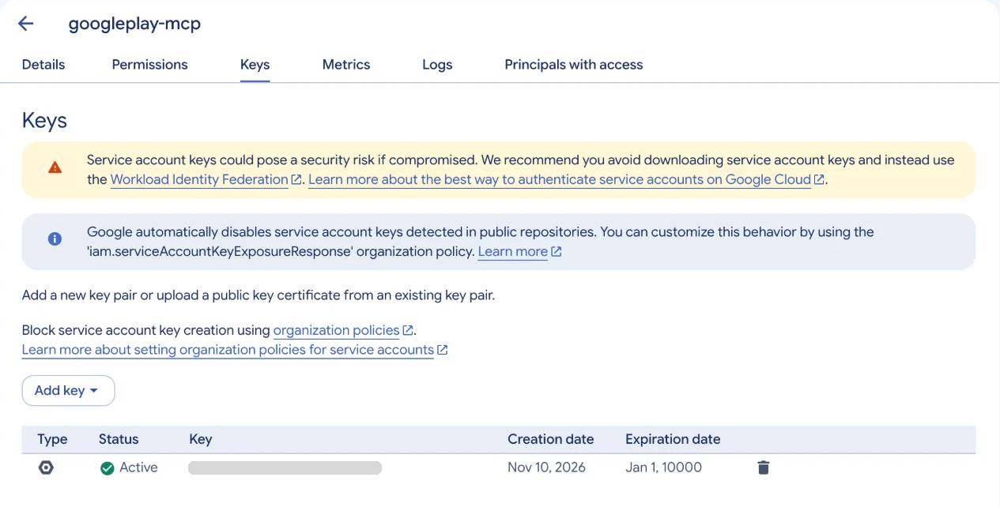
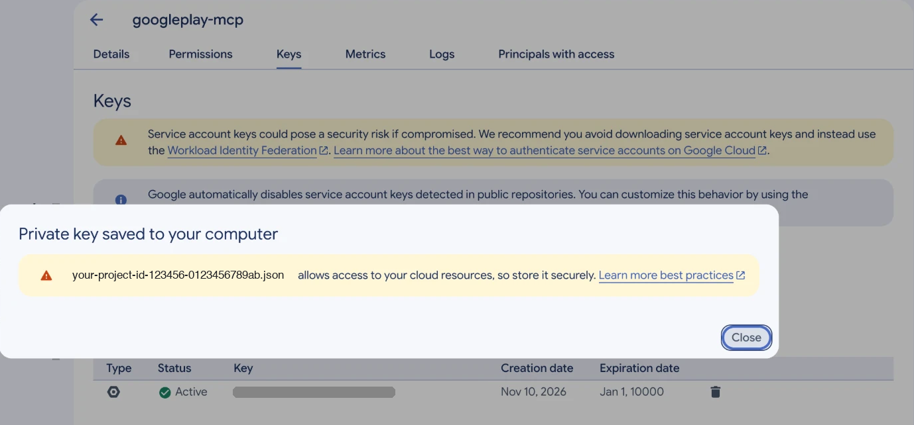

# Setup guide

Five minutes, once. You create a Google Cloud **service account**, give it
access to your apps in **Play Console**, and point the server at its key file.

> Console screens get renamed from time to time. The steps below describe the
> flow as of late 2026; if a label differs, look for the nearest equivalent.

## 1. Prerequisites

- **Node.js 18 or newer** (`node --version`).
- A **Google Play Console** developer account in which you are the owner or an
  admin (you need permission to invite users).
- An MCP client (Claude Code, Claude Desktop, Cursor, Codex, …).

## 2. Create a service account and key (Google Cloud)

1. Open [console.cloud.google.com](https://console.cloud.google.com) and create
   a project (or pick an existing one). Any project works — it does not need to
   be related to the app.
2. **APIs & Services → Library** → search for **Google Play Android Developer
   API** → **Enable**.
   - Optional, for the `list_apps` / `reporting_*` tools: also enable **Google
     Play Developer Reporting API**.
3. **IAM & Admin → Service Accounts → Create service account**. Fill in only
   the first field:
   - **Service account name:** anything, e.g. `googleplay-mcp`.
   - **Service account ID:** fills itself in from the name — leave it.
   - **Description:** optional.

   

4. Click **Create and continue**. The **Permissions** step that opens is for
   Google Cloud roles, and the service account needs none — its access comes
   from Play Console (section 3). Leave **Select a role** empty, skip
   **Principals with access** too, and click **Done**.

   

5. In the service accounts list, click the account you just created and open
   the **Keys** tab. Click **Add key → Create new key**, choose **JSON**, and
   click **Create**.

   

6. A `.json` file downloads straight away and the console confirms it. This
   file is the only credential the server needs, and Google will not show it
   again — if you lose it, delete the key here and create a new one.

   

7. Copy the service account's email address from the **Details** tab
   (`googleplay-mcp@your-project-id.iam.gserviceaccount.com`) — you need it
   next.

> If **Create new key** is greyed out or fails with "Service account key
> creation is disabled", your Google Cloud organisation enforces the
> `iam.disableServiceAccountKeyCreation` policy. An organisation admin has to
> lift it for this project under **IAM & Admin → Organization Policies**.

## 3. Grant access in Play Console

A new service account can see **nothing** until you invite it.

1. Open [play.google.com/console](https://play.google.com/console) →
   **Users and permissions** → **Invite new users**.
2. Paste the **service account email**.
3. Under **App permissions**, add the app(s) the server should manage, then
   choose permissions. Grant only what you'll use:

   | To do this | Grant |
   |---|---|
   | Read listings, tracks, builds | View app information (read-only) |
   | Edit title, descriptions, screenshots | Manage store presence |
   | Upload builds, release to internal / closed / open testing | Release apps to testing tracks |
   | Release to production, change rollout % | Release to production, exclude devices, and use Play App Signing |
   | Manage in-app products and subscriptions, prices | Manage store presence; View financial data; Manage orders and subscriptions |
   | Read and reply to reviews | Reply to reviews |
   | Vitals via the Reporting API | View app quality information (read-only) |

   The exact permission each API call needs is not something this project has
   verified against a live account — if a tool returns `403`, widen the
   permission for that area and re-run `doctor`.
4. **Invite user**. Service accounts are added immediately (there is no email
   to accept). New permissions can take a little while to take effect —
   occasionally up to a day for a brand-new service account.

## 4. Store the key safely

```bash
mkdir -p ~/.googleplay
mv ~/Downloads/your-project-*.json ~/.googleplay/service-account.json
chmod 600 ~/.googleplay/service-account.json
```

Keep it **outside any git repository**. See [SECURITY.md](SECURITY.md).

## 5. Add the server to your MCP client

### Claude Code

```bash
# --scope user installs it for ALL your projects (recommended).
# Remove the --scope user line to install for the current project only.
claude mcp add googleplay-api \
  --scope user \
  --env GOOGLE_SERVICE_ACCOUNT_JSON="$HOME/.googleplay/service-account.json" \
  -- npx -y googleplay-api-mcp
```

### Claude Desktop

Edit `~/Library/Application Support/Claude/claude_desktop_config.json` (macOS)
or `%APPDATA%\Claude\claude_desktop_config.json` (Windows):

```json
{
  "mcpServers": {
    "googleplay-api": {
      "command": "npx",
      "args": ["-y", "googleplay-api-mcp"],
      "env": {
        "GOOGLE_SERVICE_ACCOUNT_JSON": "/Users/you/.googleplay/service-account.json"
      }
    }
  }
}
```

Restart Claude Desktop.

### Cursor / Windsurf / other clients

Same block, different file — see [CLIENTS.md](CLIENTS.md).

## 6. Verify

Ask your assistant: **"Run the Google Play doctor for com.example.app."**

`doctor` checks the Node version, that the key parses, that Google issues a
token, and — given a `packageName` — that the service account can really open
an edit on that app. It changes nothing.

## Alternative: passing the key without a file path

For containers and CI, where files are awkward:

```bash
# base64 of the key file, injected as a secret
GOOGLE_SERVICE_ACCOUNT_JSON_BASE64="$(base64 -i service-account.json)"
```

`GOOGLE_SERVICE_ACCOUNT_JSON` may also hold the raw JSON itself (it's treated
as inline JSON when it starts with `{`). `GOOGLE_APPLICATION_CREDENTIALS` is
honoured as a fallback path.

## Optional: start in safe mode

To let an agent look but not touch, add `"PLAY_MCP_READ_ONLY": "true"` to the
`env` block. To allow everyday work but keep the high-impact actions manual:

```json
"env": {
  "GOOGLE_SERVICE_ACCOUNT_JSON": "/Users/you/.googleplay/service-account.json",
  "PLAY_MCP_ALLOW_PRODUCTION_RELEASE": "false",
  "PLAY_MCP_ALLOW_PRICE_CHANGES": "false"
}
```

## Troubleshooting

| Symptom | Likely cause |
|---|---|
| `Provide the service account key via GOOGLE_SERVICE_ACCOUNT_JSON…` | The env var isn't reaching the server. Use an absolute path; `~` is not expanded inside JSON config. |
| `Google OAuth token request failed: 400 — invalid_grant` | The key was deleted or the machine clock is badly off. Create a new key. |
| `403 PERMISSION_DENIED` on every call | The service account wasn't invited in Play Console, or the permission hasn't propagated yet. |
| `403` naming the API as disabled | Enable **Google Play Android Developer API** in the service account's Cloud project. |
| `404` on a valid package | The app belongs to a different developer account, or the package name is misspelled. |
| `Only releases with status draft may be created on draft app` | The app has never been published; create `draft` releases until its first review completes in Play Console. |
| Commit error mentioning `changesNotSentForReview` | Re-run with `changesNotSentForReview: true` (or drop it, if the error says it is not allowed). |
| `list_reviews` returns little or nothing | The API only serves reviews from roughly the last week that include a text comment. |
| `list_apps` / `reporting_*` fail | The optional **Google Play Developer Reporting API** isn't enabled. |

### Multiple Node versions (the most common startup crash)

If your MCP client launches an old Node (< 18), the server won't start. Point
`command` at an absolute path to a modern `npx`
(e.g. `/opt/homebrew/bin/npx`), or set `PATH` in the `env` block.
